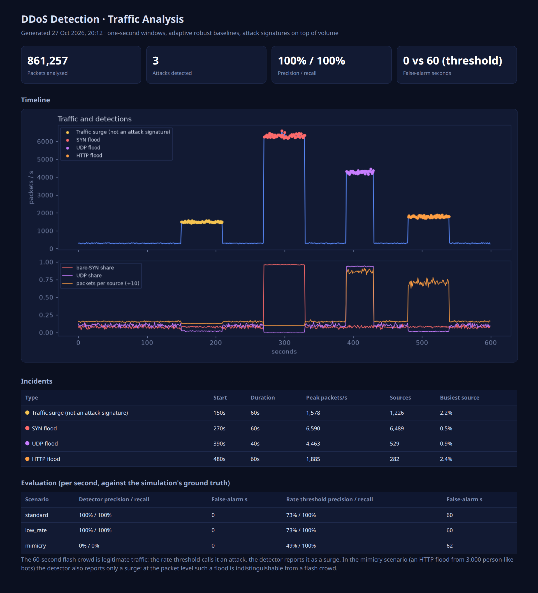

# DDoS Detector: Traffic Pattern Analysis

Detects DDoS attacks in packet traffic, names the attack type, and tells a **legitimate
flash crowd** (a sale or results day) apart from an attack. A plain packet-rate threshold
cannot do that.



## How it works

1. **Windows**: packets are grouped into one-second windows. For each window it computes
   packets, bytes, distinct sources, normalised source entropy, the share of bare SYNs
   (connections never completed), the UDP share, packets per source, and the busiest
   source's share.
2. **Adaptive robust baseline**: each feature gets a z-score against the median and MAD of
   the last 60 seconds that were *not* flagged, so an ongoing attack can't raise its own
   baseline.
3. **Signatures on top of volume**: a volume jump alone is reported as a *surge*. It
   becomes an attack only when the make-up of the traffic also changes:

   | Attack | Signature |
   |---|---|
   | SYN flood | bare-SYN share jumps (half-open connections from spoofed sources) |
   | UDP flood | UDP share jumps |
   | HTTP flood | packets per source jump (a few clients far busier than any person) |

## Results

Packet-level simulation (`ddos/traffic.py`): 10 minutes of normal traffic (~300 packets/s
from 2,500 clients with a Zipf activity distribution), plus episodes labelled with ground
truth. Evaluation is per second ([`docs/metrics.json`](docs/metrics.json)):

| Scenario | Detector precision / recall | Rate threshold precision / recall |
|---|---|---|
| Standard: flash crowd, SYN flood, UDP flood and HTTP flood | **100% / 100%**, 0 false-alarm seconds | 73% / 100%, 60 false-alarm seconds (the flash crowd) |
| Low-rate: the same attacks at only 300–500 packets/s | **100% / 100%** | 73% / 100% |
| Mimicry: an HTTP flood from 3,000 bots, each as slow as a person | 0% / 0% (reported only as a surge) | 49% / 100% |

The attack type was right for every detected second.

**Limitations, stated plainly.** The traffic is simulated, so these scenarios are cleaner
than a real network. The mimicry scenario is a real blind spot: at the packet level, a
flood of person-like bots looks the same as a flash crowd. Catching it takes
application-level signals (sessions, CAPTCHAs, behaviour), which is why surges are still
reported to the operator rather than ignored.

## Run it

```sh
python -m venv .venv && .venv/bin/pip install -r requirements.txt
.venv/bin/python -m ddos demo                   # out/report.html and out/metrics.json
.venv/bin/python -m ddos analyze packets.csv    # your own packets: ts, src, proto, flags, dport, size
.venv/bin/python -m pytest
```
